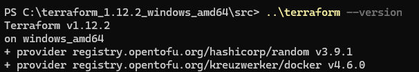
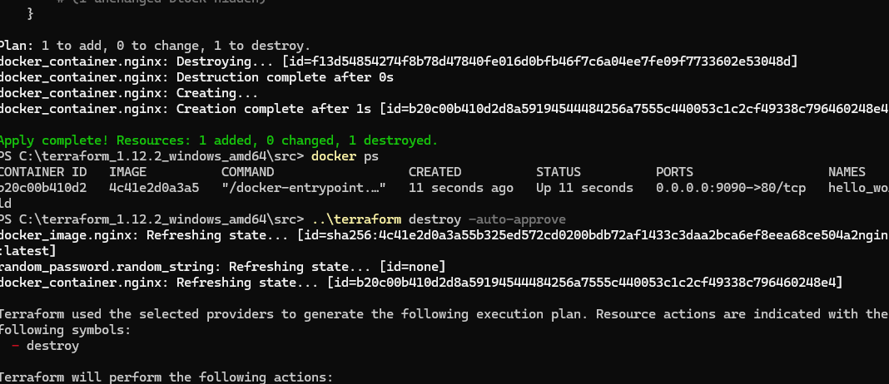
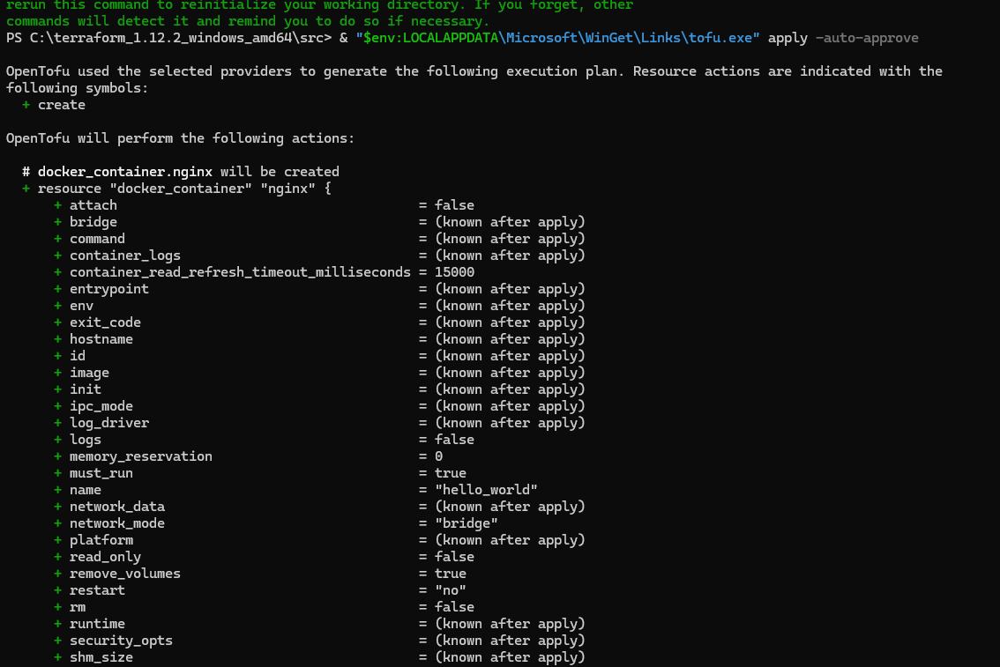

# Отчёт о выполнении домашнего задания к занятию «Введение в Terraform»

## Чек-лист готовности


---

## Выполнение Задания 1

### Пункт 2. Анализ файла .gitignore
**Ответ:** Личную и секретную информацию допустимо сохранить в файле **`personal.auto.tfvars`** (или в любых файлах с расширением `*.auto.tfvars`, а также в `terraform.tfvars`, если они внесены в исключения). Git автоматически игнорирует эти файлы, защищая секреты от попадания в публичный репозиторий.

### Пункт 3. Секрет из state-файла
**Ответ:** Конкретный ключ и значение из файла `terraform.tfstate`:
```json
"result": "УКАЖИТЕ_ВАШ_ПАРОЛЬ_ИЗ_TFSTATE_ФАЙЛА"
```

### Пункт 4. Ошибки и исправление кода
**Объяснение ошибок в коде:**
1. **Строка 23 (`docker_image`):** Пропущено локальное имя ресурса. Должно быть два ярлыка: `resource "тип" "имя"`.
2. **Строка 28 (`docker_container`):** Имя ресурса `"1nginx"` начинается с цифры, что запрещено синтаксисом Terraform.
3. **Строка 30 (`name`):** Ссылка на несуществующий ресурс `random_string_FAKE` (вместо `random_string`) и опечатка в регистре свойства `.resulT` (правильно — `.result`).

**Исправленный фрагмент кода:**
```hcl
resource "docker_image" "nginx" {
  name         = "nginx:latest"
  keep_locally = true
}

resource "docker_container" "nginx" {
  image = docker_image.nginx.image_id
  name  = "example_\${random_password.random_string.result}"

  ports {
    internal = 80
    external = 9090
  }
}
```

**Вывод команды `docker ps`:**


### Пункт 5. Переименование в hello_world и ключ -auto-approve
**Исправленный фрагмент кода:**
```hcl
name  = "hello_world"
```

**Объяснение ключа `-auto-approve`:**
* **Опасность:** Полностью отключает ручную проверку и подтверждение плана изменений (`yes/no`). Из-за опечатки можно случайно уничтожить важную инфраструктуру или базы данных без предупреждения.
* **Зачем нужен:** Необходим для автоматизации процессов деплоя в **CI/CD пайплайнах** (GitHub Actions, GitLab CI), где сборку выполняет скрипт и физически некому вводить подтверждение в консоли.

**Вывод команды `docker ps`:**


### Пункт 6. Содержимое файла terraform.tfstate после destroy
```json
{
  "version": 4,
  "terraform_version": "1.12.2",
  "serial": 11,
  "lineage": "ваш-уникальный-id",
  "outputs": {},
  "resources": [],
  "check_results": null
}
```

### Пункт 7. Почему не был удалён Docker-образ nginx:latest
**Ответ из кода:** В блоке `docker_image` установлен параметр `keep_locally = true`.

**Строка из документации провайдера:**
> *«If true, then the Docker image won't be deleted on destroy operation. If this is false, it will delete the image from the docker local storage on destroy operation.»*

---

## Выполнение Задания 2* (Дополнительное)

**Примечание:** Выполнение данного задания временно отложено и пропущено. В связи с техническими причинами на стороне облачного провайдера виртуальные машины в Yandex Cloud в данный момент недоступны. Все работы перенесены и выполняются на локальной рабочей станции Windows.

---

## Выполнение Задания 3* (Дополнительное)

### 1. Установка OpenTofu
* **Выполнено:** Утилита успешно установлена в операционной системе Windows через пакетный менеджер `winget`. Прямой вызов исполняемого файла подтвердил корректную установку версии **OpenTofu v1.13.1**:
  ```powershell
  & "\$env:LOCALAPPDATA\Microsoft\WinGet\Links\tofu.exe" --version
  ```

### 2. Выполнение конфигурации через tofu apply
Была произведена успешная инициализация и запуск локальной инфраструктуры (контейнера Nginx) с помощью форка OpenTofu командами:
```powershell
& "\$env:LOCALAPPDATA\Microsoft\WinGet\Links\tofu.exe" init
& "\$env:LOCALAPPDATA\Microsoft\WinGet\Links\tofu.exe" apply -auto-approve
```

**Вывод консоли при успешном развёртывании через OpenTofu:**

