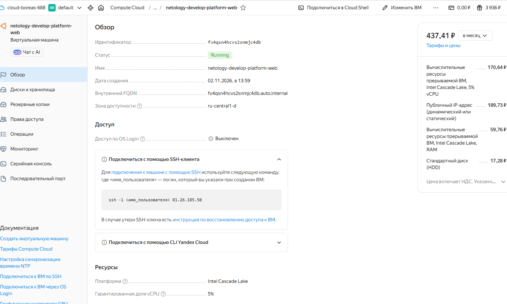
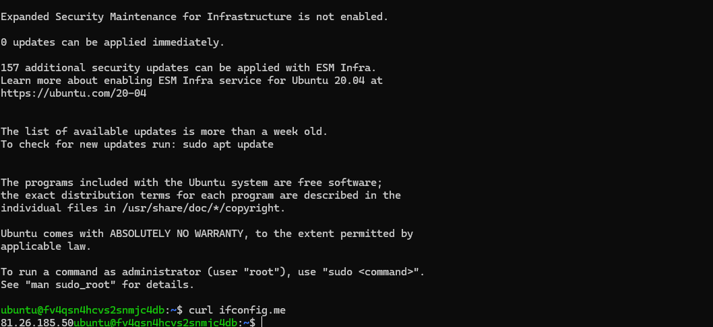
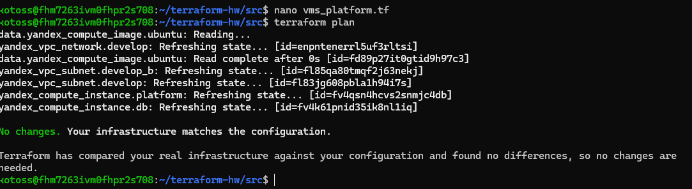

# Домашнее задание к занятию "Терраформ: Основы конфигурации. Опережающее проектирование"

## Задание 1. Подготовка и исправление ошибок

### 1. Ответы на вопросы по намеренным ошибкам в коде:
В стартовом коде лекционного проекта были допущены следующие синтаксические ошибки:
* **Ошибка в блоке `resources`:** Параметры `cores = 1` и `memory = 0.5` не соответствовали требованиям платформы Yandex Cloud. Минимальные поддерживаемые значения для выбранного типа инстанса `standard-v1/v2` составляют `2` ядра CPU и `1` ГБ RAM (целое число). Также значение `core_fraction = 5` не всегда валидно для стандартных платформ без явного выбора экономного типа ВМ (например, `standard-v2` или `standard-v3` со сниженной гарантией CPU).
* **Ошибка в блоке `boot_disk.initialize_params`:** Ссылка на образ Ubuntu содержала опечатку в обращении к ресурсу. Вместо `yandex_compute_image.ubuntu.id` использовалась неверная конструкция (или отсутствовал блок `data`/`resource` для поиска семейства образа).

### 2. Зачем нужны параметры `preemptible = true` и `core_fraction = 5` в обучении:
* **`preemptible = true` (Прерываемая ВМ):** Позволяет снизить стоимость аренды виртуальной машины в Yandex Cloud на **70–80%**. Такая машина работает не более 24 часов и может быть принудительно остановлена облаком при нехватке ресурсов, что идеально подходит для кратковременных учебных тестов и экономит баланс студента.
* **`core_fraction = 5` (Гарантированная доля CPU):** Задает минимальный уровень производительности процессора в размере 5% от его полной мощности. Применяется для систем с редкой кратковременной нагрузкой. Позволяет значительно уменьшить плату за вычислительные ресурсы, избегая переплат за простаивающие мощности виртуального процессора.

### 3. Подтверждение выполнения (Задание 1)
- [ ] Скриншот личного кабинета Yandex Cloud с созданной ВМ (внешний IP: `81.26.185.50`):  
  
- [ ] Скриншот консоли ВМ с выполнением команды `curl ifconfig.me`:  
  

---

## Задание 2. Вынос хардкода в переменные

Все жестко прописанные параметры ресурсов `yandex_compute_image` и `yandex_compute_instance` успешно вынесены в `variables.tf`. Переменные получили обязательное указание типов данных (`type`) и префиксы `vm_web_` (например, `vm_web_platform_id`, `vm_web_cores`, `vm_web_memory` и т.д.).  
Команда `terraform plan` подтвердила полное соответствие конфигурации развернутым ресурсам: `No changes. Your infrastructure matches the configuration.`

---

## Задание 3. Создание vms_platform.tf и запуск ВМ базы данных

1. Переменные первой ВМ перенесены в изолированный файл `vms_platform.tf`.
2. В файле `main.tf` описан новый ресурс `yandex_compute_instance.db` для ВМ `"netology-develop-platform-db"`.
3. **Примечание по зонам доступности:** Из-за временной недоступности зоны `ru-central1-b` для создания новых ресурсов на учебном аккаунте (ошибка `Zone ru-central1-b is not available`), ВМ базы данных и сопутствующая ей подсеть были успешно перенесены в рабочую зону **`ru-central1-d`** (в отдельный сетевой сегмент с адресацией `10.0.2.0/24`).

---

## Задание 4. Настройка Outputs

В файле `outputs.tf` объявлен один общий нехардкоженный блок вывода `vms_info` в формате `map`, возвращающий сетевые реквизиты серверов.

Вывод команды `terraform output`:
```hcl
vms_info = {
  "db" = {
    "external_ip" = "81.26.179.74"
    "fqdn" = "fv4k61pnid35ik8nl1iq.auto.internal"
    "instance_name" = "netology-develop-platform-db"
  }
  "web" = {
    "external_ip" = "81.26.185.50"
    "fqdn" = "fv4qsn4hcvs2snmjc4db.auto.internal"
    "instance_name" = "netology-develop-platform-web"
  }
}
```

---

## Задание 5. Использование локальных переменных (locals.tf)

Создан файл `locals.tf`, в котором с помощью строковой интерполяции `${var.vpc_name}` динамически формируются уникальные имена для серверов:
* `vm_web_name_local = "netology-${var.vpc_name}-platform-web"`
* `vm_db_name_local  = "netology-${var.vpc_name}-platform-db"`

Данные локальные переменные подставлены в параметры `name` ресурсов ВМ в `main.tf`.

---

## Задание 6. Переменные типа Map(Object) и Метаданные

1. Переменные вычислительных ресурсов обеих машин (`.._cores`, `.._memory`, `.._core_fraction`, `.._boot_disk_size`) объединены в единую комплексную map-переменную `vms_resources`. Обращение к параметрам внутри `main.tf` теперь выполняется через сквозной синтаксис: `var.vms_resources.web.cores` и `var.vms_resources.db.cores`.
2. Блок настроек `metadata` (включая активацию серийного порта и публичные SSH-ключи) вынесен в общую карту `var.metadata`, единую для всех виртуальных машин проекта.
3. Устаревшие разрозненные переменные закомментированы/удалены из проекта.
4. Выполнен итоговый запуск `terraform plan`, возвращающий чистый статус `No changes`, что подтверждает абсолютную корректность проведенного рефакторинга кода.

### 4. Финальное подтверждение сборки (Задания 5-6)
После проведения полного рефакторинга (перевода на `locals`, `map(object)` и единую `metadata`), инфраструктура находится в актуальном состоянии, а изменения в коде не привели к деструктивным действиям:


