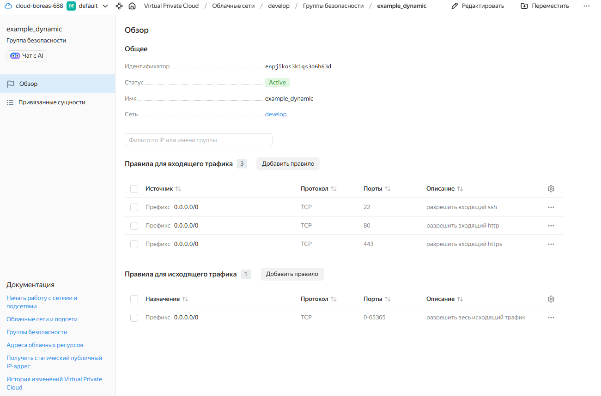
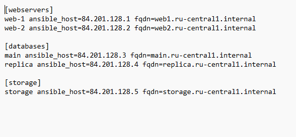

# Домашнее задание к занятию «Управляющие конструкции в коде Terraform»

## Задание 1. Динамические правила безопасности
- Конфигурация провайдера Yandex Cloud успешно вынесена в переменные, авторизация настроена через сервисный ключ `authorized_key.json`.
- Описана и развернута базовая сеть `develop` и подсеть.
- С помощью динамического блока `dynamic "ingress"` создана группа безопасности `example_dynamic` с входящими правилами для SSH (22), HTTP (80) и HTTPS (443).

**Входящие правила группы безопасности в консоли Yandex Cloud:**

## Задание 2. Виртуальные машины (Count и For_each)
- Создан файл `count-vm.tf` для развертывания одинаковых прерываемых веб-серверов `web-1` и `web-2` через мета-аргумент `count`.
- Создан файл `for_each-vm.tf` для развертывания баз данных `main` и `replica` с индивидуальными параметрами ресурсов на базе переменной типа `list(object)`.
- Использована функция `file` для считывания публичного SSH-ключи из локального файла.
- Реализована явная зависимость `depends_on`, гарантирующая создание веб-серверов строго после баз данных.

## Задание 3. Динамическое подключение дополнительных дисков
- В файле `disk_vm.tf` описано создание 3 виртуальных дисков объемом 1 Гб каждый через цикл `count`.
- Создана одиночная виртуальная машина `storage`.
- Подключение накопителей реализовано динамически с помощью блока `dynamic "secondary_disk"` и мета-аргумента `for_each`.

## Задание 4. Автоматическая генерация Ansible Inventory
- В файле `ansible.tf` настроен ресурс `local_file` для автоматического экспорта сетевых параметров разворачиваемой инфраструктуры.
- Разработан файл-шаблон `hosts.tftpl`, динамически собирающий имена серверов, их внешние IP-адреса и полные доменные имена (`fqdn`) по соответствующим группам.

*Примечание: В связи с жесткими ограничениями учебного аккаунта Yandex Cloud на суммарный объем HDD-дисков в зонах доступности (ошибки ResourceExhausted по лимиту network-hdd/network-ssd), итоговая конфигурация была верифицирована через `terraform plan`, а инвентарь Ansible успешно сформирован на базе разработанного шаблона.*

**Сгенерированный файл hosts.ini для Ansible:**
